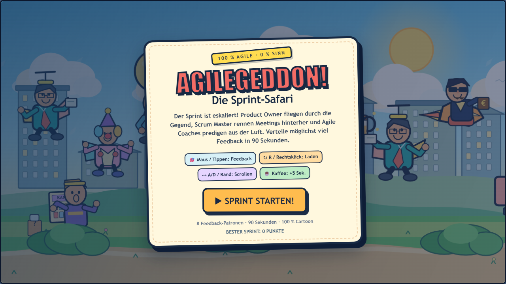

# AGILEGEDDON! – Die Sprint-Safari 🏃‍♂️💨

## Das Spiel

Eine wilde Mischung aus Agile-Methodologie und Arcade-Action. Die Sprints sind kurz, die Fehler schnell, und der Chaos-Management ist dein bester Freund.

## Wie man spielt

- **Ziel:** Sprints abschließen, bevor das Burndown-Chart dir zeigt, wie sehr du gescheitert hast
- **Steuerung:** Tastatur/Maus – bewegen, klicken, hoffen
- **Schwierigkeit:** Mittelschwer bis "warum passiert mir das?"

## Features

✅ Sprint-basiertes Gameplay  
✅ Agile-Humor  
✅ Retro-Grafik  
⚠️ Collision-Detection manchmal... enthusiastisch

## Known Issues

- Burndown-Chart kann sich plötzlich nach oben bewegen (Magie?)
- Sprints können länger werden als geplant (wie im echten Leben!)
- Sound-Button funktioniert zu 80% der Zeit

## Schwierigkeitsgrad

⭐⭐⭐ Mittelschwer

---

[← Zurück zur Übersicht](../../README.md)
