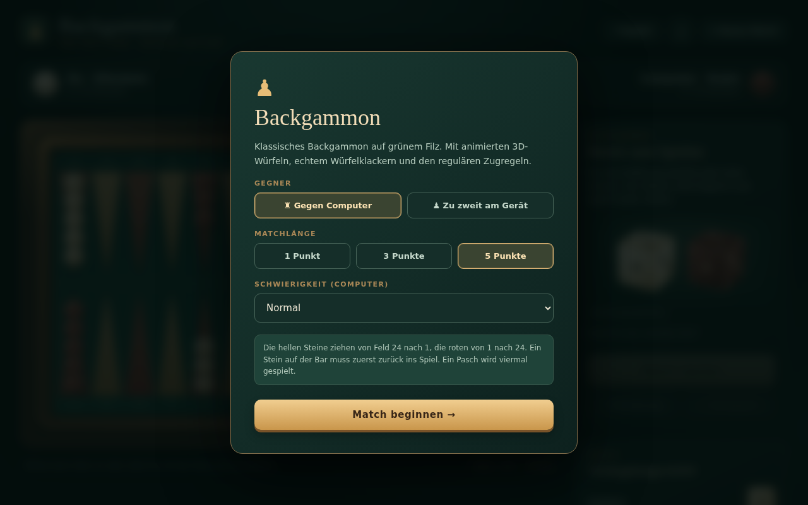

# Backgammon · The Felt Club 🎲

## Das Spiel

Der Klassiker auf dem Filztisch – vollständig im Browser, ohne Installation. Zwei Spieler (du gegen den Computer) kämpfen darum, als Erster alle 15 Steine ins Heimfeld zu bringen und auszuwürfeln. Mit korrektem Verdopplungswürfel, Crawford-Regel und animierten 3D-Würfeln.

## Wie man spielt

- **Ziel:** Alle eigenen Steine (Elfenbein) ins Heimfeld bewegen und auswürfeln
- **Zugregeln:** Klick auf einen eigenen Stein, dann auf das Zielfeld – legale Züge werden markiert
- **Würfeln:** Über den „Würfeln"-Button – bei einem Pasch stehen vier Züge zur Verfügung
- **Verdopplungswürfel:** Mit dem „Verdoppeln"-Button den Spielwert erhöhen; der Gegner kann ablehnen oder annehmen
- **Rückgängig:** Einzelne Züge können innerhalb eines Zugs zurückgenommen werden

## Features

✅ Vollständige Backgammon-Regeln  
✅ Verdopplungswürfel (Doubling Cube) mit Ablehnen/Annehmen  
✅ Crawford-Regel (kein Verdoppeln im entscheidenden Spiel)  
✅ Match-System: 1 bis 9 Punkte einstellbar  
✅ 3D-animierte Würfel  
✅ Spieler vs. Computer-KI  
✅ Spielzug-Log  
✅ Soundeffekte  
✅ Rückgängig-Funktion  
✅ Regeln-Modal mit vollständiger Spielerklärung  

## Schwierigkeitsgrad

⭐⭐⭐ Mittel – die KI spielt solide, macht aber keine perfekten strategischen Entscheidungen

---

[← Zurück zur Übersicht](../../README.md)
