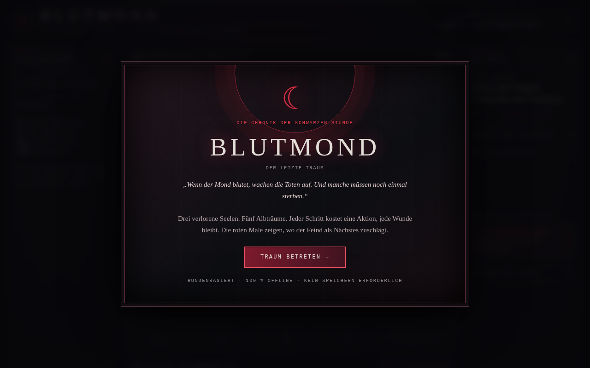
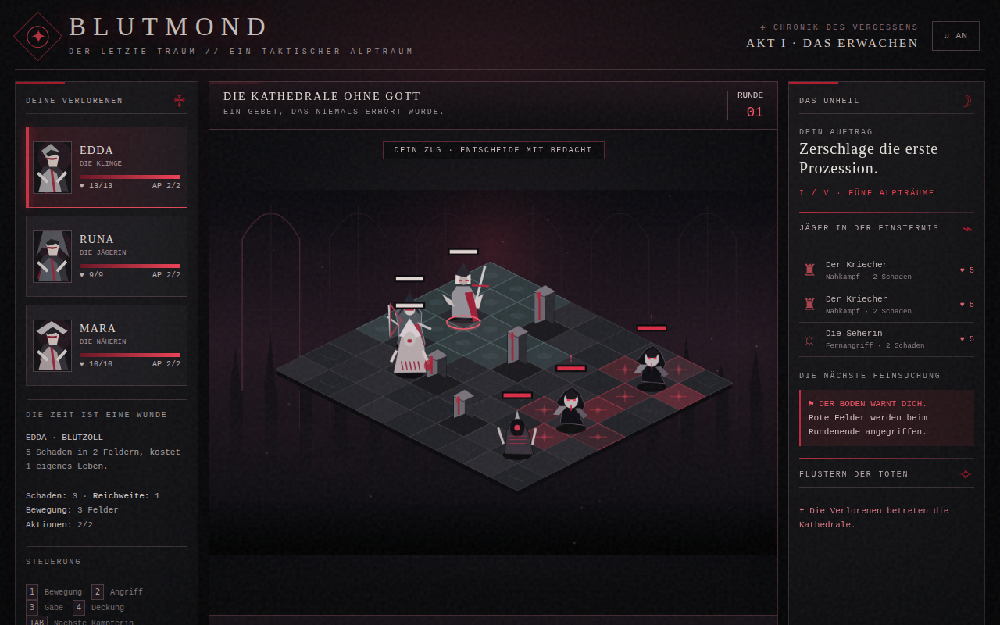
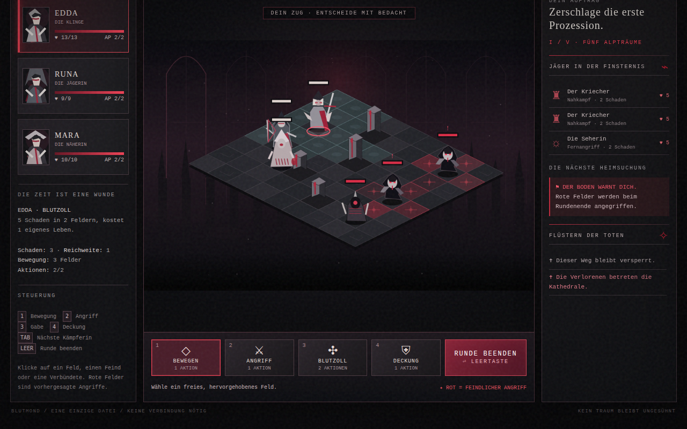

# Blutmond — Der letzte Traum 🌑⚔️

## Das Spiel

Rundenbasiertes taktisches Strategiespiel im Dark-Gothic-Fantasy-Setting. Drei Kriegerinnen kämpfen sich durch fünf alptraumhafte Schauplätze gegen Untote, Seher und einen Endgegner — alles verpackt in tiefem Dunkelrot und Kerzenlicht-Ästhetik.

## Wie man spielt

- **Ziel:** Alle fünf Szenen überleben und den Glockenhirten besiegen
- **Steuerung:** Klick auf Einheit zum Auswählen, dann Aktion wählen (Bewegen / Angreifen / Fähigkeit / Deckung)
- **Aktionspunkte:** 2 AP pro Einheit pro Runde
- **Relics:** Nach jeder Szene eine Reliquie wählen — Entscheidungen haben Konsequenzen

## Charaktere

| Einheit | Rolle | Besonderheit |
|---------|-------|--------------|
| **EDDA** | Die Klinge | Nahkämpferin, hoher Schaden |
| **RUNA** | Die Jägerin | Fernkämpferin, taktische Reichweite |
| **MARA** | Die Näherin | Support, heilende Fähigkeiten |

## Features

✅ Isometrisches 9×8 Grid  
✅ Turn-Based Taktik mit AP-System  
✅ 5 einzigartige Szenen / Kapitel  
✅ Relic-System zwischen den Kämpfen  
✅ Prozedurale Audio via Web Audio API (kein externes Asset)  
✅ 100% offline — ein einziges HTML-File

## Known Issues

- Pathfinding kann auf engem Grid manchmal haken
- Relic-Kombinationen sind nicht vollständig ausbalanciert
- Boss-Mechaniken können überraschend aggressiv skalieren

## Schwierigkeitsgrad

⭐⭐⭐⭐ Gothic und gnadenlos

---

[← Zurück zur Übersicht](../../README.md)
