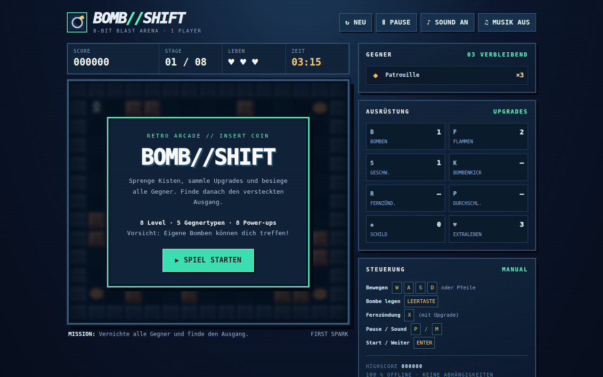
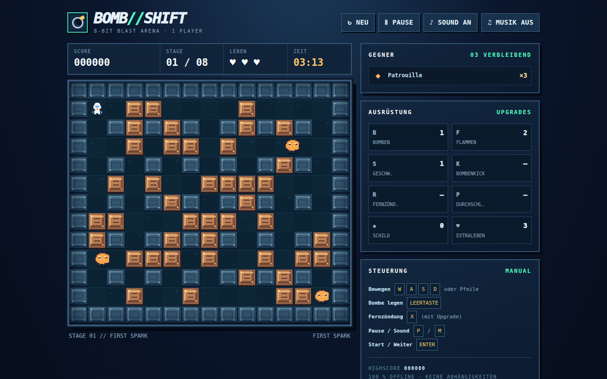
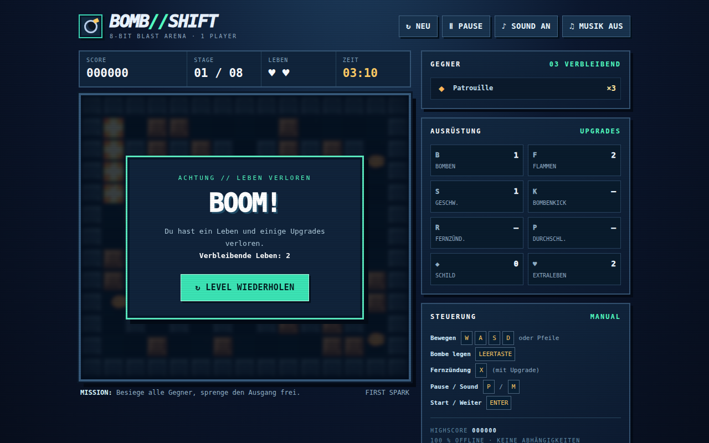

# BOMB//SHIFT — Retro Arcade ⚡💣

## Das Spiel

Schnelles Action-Arcade-Game. Shiften, ausweichen, Bomben werfen, überleben. Alles in Retro-Ästhetik.

## Wie man spielt

- **Ziel:** Level überleben, Boss besiegen, oder einfach lange leben
- **Steuerung:** Pfeiltasten – bewegen, Leerzeichen – Bomben shiften
- **Power-ups:** Hier und dort verteilt (manchmal hilfreich, manchmal zerstörerisch)

## Features

✅ Schnelles Gameplay  
✅ Retro Pixel-Grafik  
✅ Progressive Schwierigkeit  
✅ Boss-Fights  
⚠️ Hitbox-Detection kann großzügig sein

## Known Issues

- Bomben-Physik nicht immer transparent
- Power-ups können exploitiert werden (oder nutzlos sein)
- Performance-Drop bei vielen Explosionen

## Schwierigkeitsgrad

⭐⭐⭐ Mittel

---

[← Zurück zur Übersicht](../../README.md)
