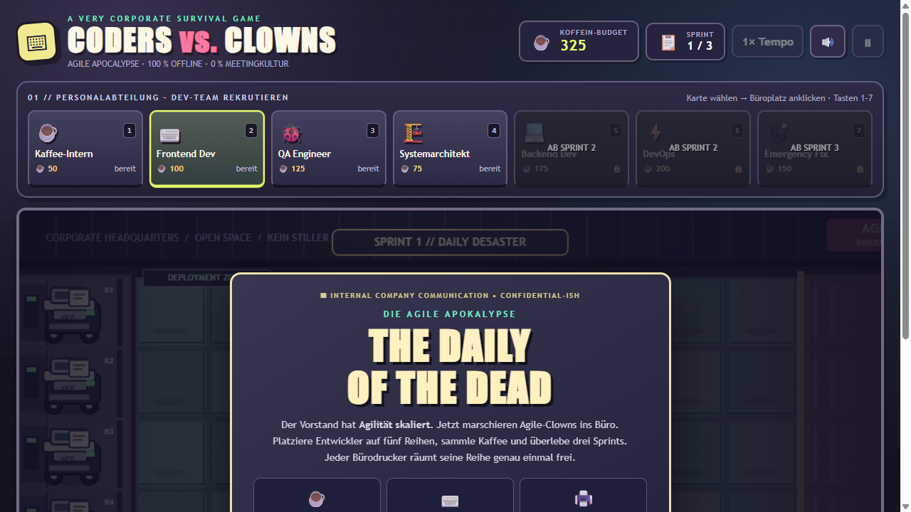

# CODERS vs. CLOWNS – Agile Apocalypse 👨‍💻 vs 🤡

## Das Spiel

Ein chaotisches Duell zwischen den zwei mächtigsten Kräften der Unternehmenskultur: Programmierer und Clowns. Nur einer wird überleben.

## Wie man spielt

- **Ziel:** Den gegnerischen Team-Health auf 0 bringen (oder die Bugs einfach gewinnen lassen)
- **Steuerung:** Tastatur – Angriffe, Spells, Witze
- **Spielmodi:** 1v1, Story-Mode, "Warum hab ich das geklickt"-Mode

## Features

✅ PvP Kampf-System  
✅ Unterschiedliche Charakter-Fähigkeiten  
✅ Agile-Humor trifft Slapstick  
✅ Sound-Effekte (manchmal laut, manchmal gar nicht)  
⚠️ KI kann spontan entscheiden, dass die Spielregeln nicht für sie gelten

## Known Issues

- Clown-Special kann überpowered sein (oder total nutzlos)
- Sound-Loop manchmal stuck
- Win-Condition unklar (ist das jetzt ein Bug oder Feature?)

## Schwierigkeitsgrad

⭐⭐⭐⭐ Mittelschwer bis "warum passiert mir das?"

---

[← Zurück zur Übersicht](../../README.md)
