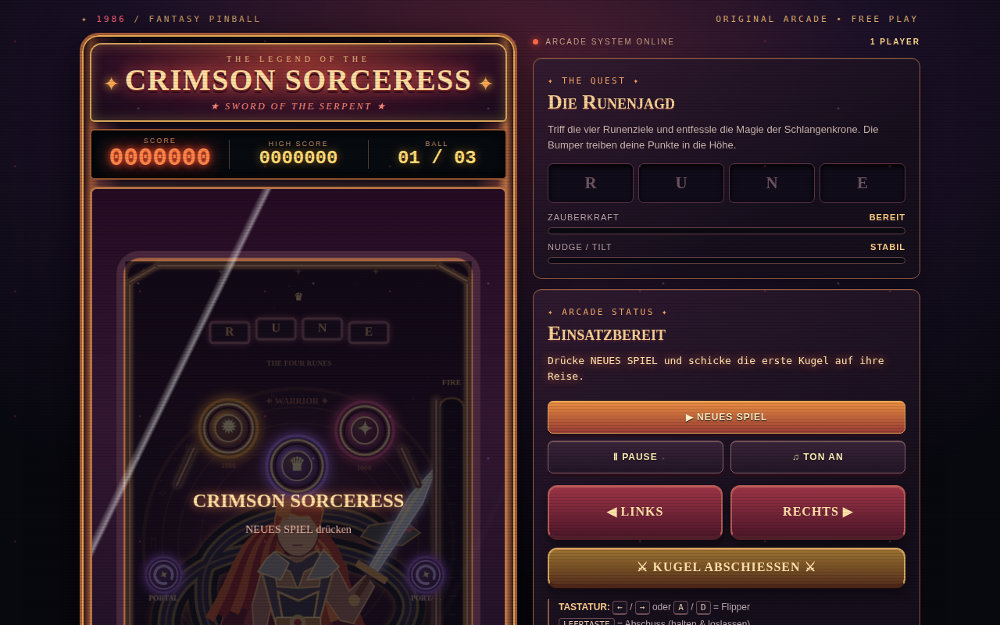
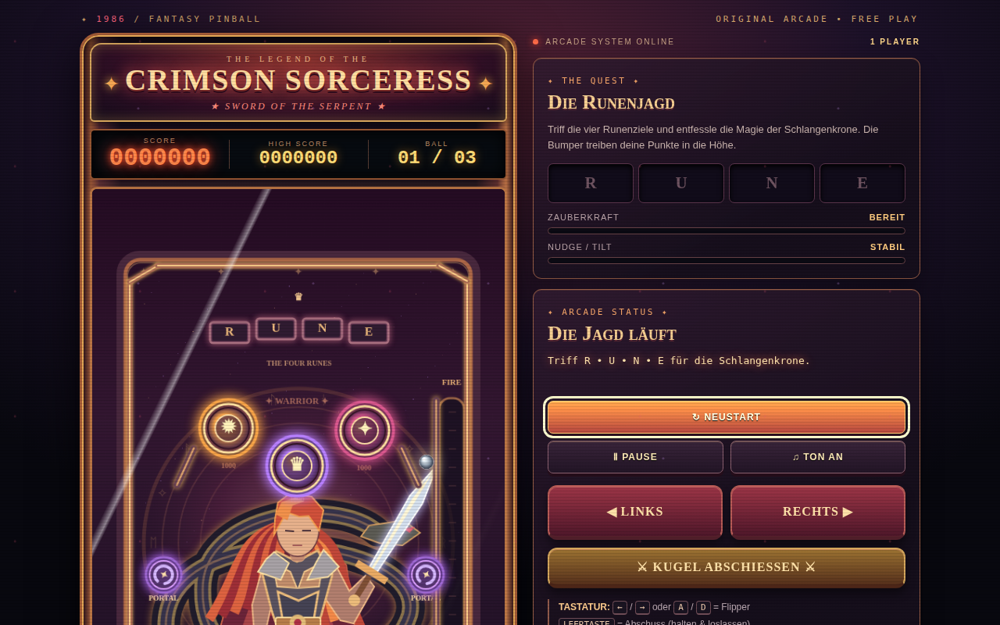

# Crimson Sorceress — Fantasy Pinball 1986 🔮🎯

## Das Spiel

Flipper-Spiel mit magischem Fantasy-Setting. Rote Hexe, bunte Ziele, Pinball-Chaos im Mittelalterlook.

## Wie man spielt

- **Ziel:** Punkte sammeln, Target-Sequenzen aktivieren, Multiball wenn möglich
- **Steuerung:** Links/Rechts Flippers mit Tasten, Power-Meter für stärkere Flips
- **Ballysics:** Chaotisch und unpredictable (wie echte Flipperspiele)

## Features

✅ Klassisches Flipper-Gameplay  
✅ Fantasy-Thema  
✅ Mehrere Ramps & Targets  
✅ Multiball-Modus  
⚠️ Ball-Physik rebellisch

## Known Issues

- Tilt-Detection manchmal überempfindlich
- Ball kann in "Dead Zones" stecken
- Flipper-Timing ist kritisch (manchmal zu kritisch)

## Schwierigkeitsgrad

⭐⭐⭐⭐ Flipper sind hart

---

[← Zurück zur Übersicht](../../README.md)
