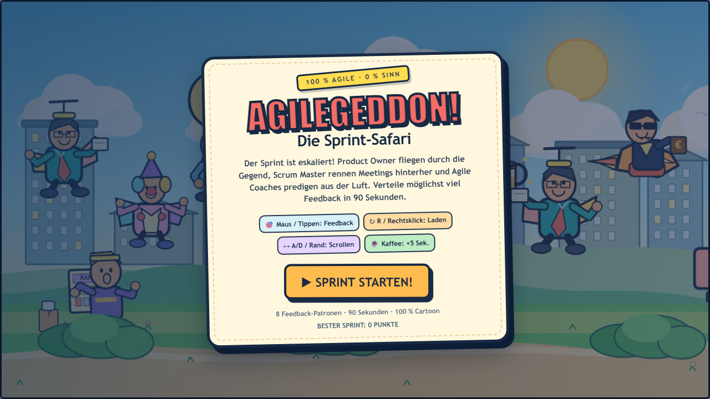

# Dunschtigs Jass – Schwizer Charte-Klassiker ♠️🃏

## Es Spiu

De Dunschtigs Jass isch de Klassiker uf em Mittwoch – jetz au im Browser! Wirf d'Charte go, weis dini Hond, machsch Stiche und sammlisch Punkte. 36 Charte, 4 Plauscherei, unendlich viel Dramatik.

## Wie me chunt

- **Ziel:** Möglichscht viu Punkte mit dinem Team mache
- **Wys-Regel:** Funktuoniert normal (Drüblatt, Vierblatt, Fünnfblatt)
- **Taktik:** Trumpf wähle, Stiche machsche, und höffe, dass dini Mitspieler de Richtigi Charte spieled

## Features

✅ Klassische Jass-Regeln (Eichle, Rose, Schelle, Schilte)  
✅ Vier Spieler (dü + 3 KI)  
✅ Wyse-Aggli (für Händ mit Seque)  
✅ Trumpf-Wahl und Schiebe-Optione  
✅ Liveness-Punktzähle mit Match-Bonüs  
✅ Schwiizerdütsch-Dialekt überall  

## Bekannti Fehler

- Charte bim Wahl-Modal sind a bitzeli unscharp (FIXD)
- Gespihlti Charte au de Tisch erschiene à bitzeli als Kant (FIXD)

## Schwierigkeitsstufe

⭐⭐⭐ Mittelschwär (KI blufft nit, aber machts ehrlich)

---

[← Zrugg zur Übersicht](../../README.md)
