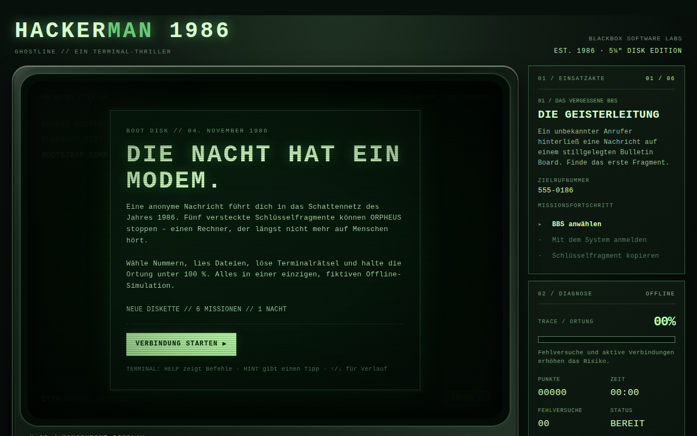
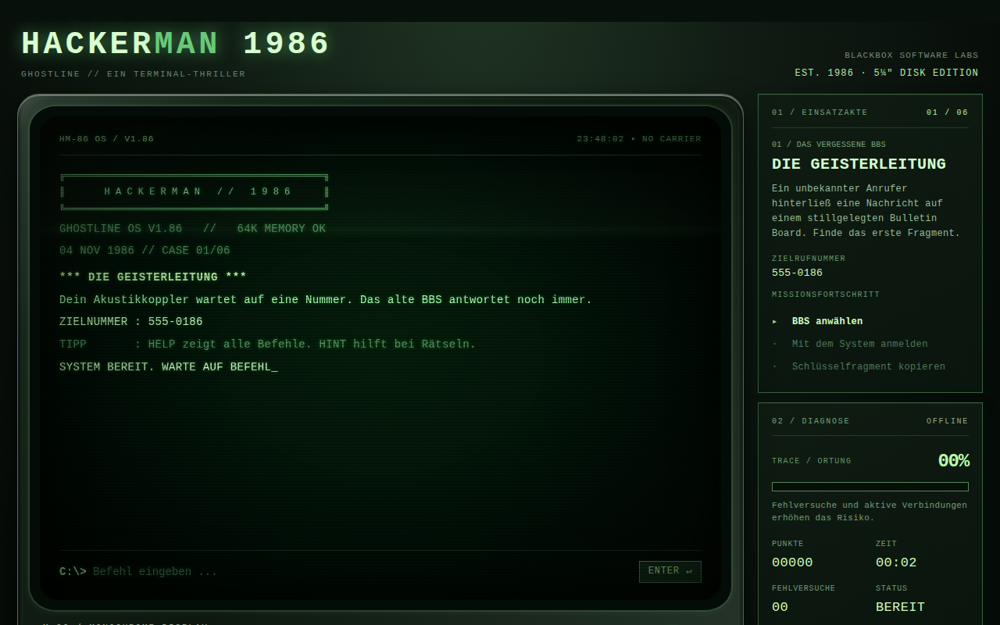
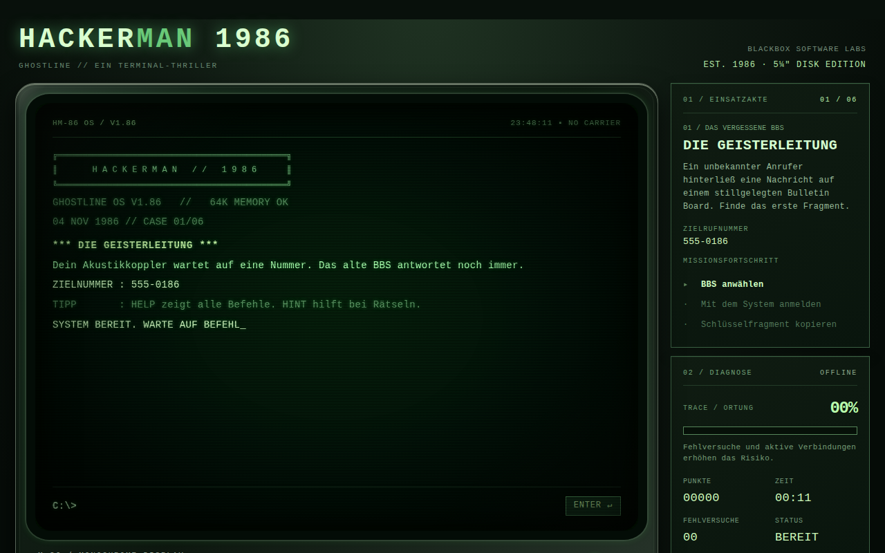

# HACKERMAN 1986 // GHOSTLINE 💻👻

## Das Spiel

Ein Hacker-Simulator aus der Vergangenheit mit Cyberpunk-Vibes. Durch Code-Labyrinthe navigieren, Systeme infiltrieren, oder auf der GHOSTLINE kommunizieren.

## Wie man spielt

- **Ziel:** Unklar (aber wahrscheinlich etwas mit Hacking)
- **Steuerung:** Terminal-Befehle oder Point-and-Click (je nachdem wie die Laune ist)
- **Atmosphäre:** 80er-Neon meets Cyberpunk

## Features

✅ Hacker-Flair  
✅ GHOSTLINE-Kommunikation  
✅ System-Infiltration  
✅ Retro-Terminal-Ästhetik  
⚠️ Spiellogik teilweise unklar

## Known Issues

- Befehle manchmal nicht erkannt (oder ignoriert)
- GHOSTLINE-Chat kann crashen
- Terminal-Output manchmal unleserlich

## Schwierigkeitsgrad

⭐⭐⭐ Weiß niemand genau

---

[← Zurück zur Übersicht](../../README.md)
