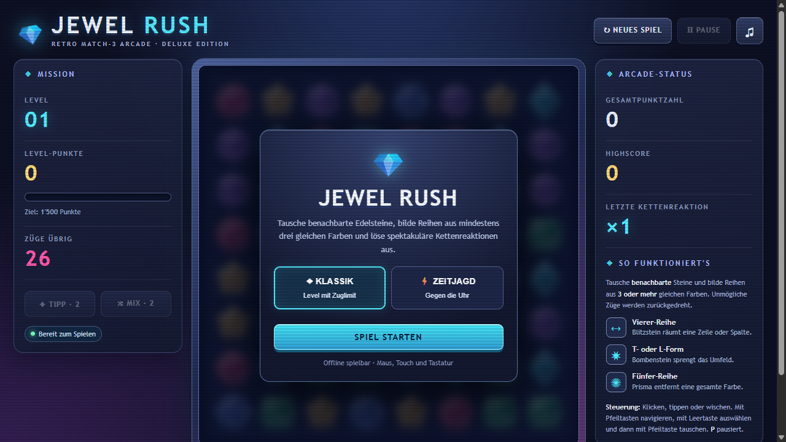

# Jewel Rush // Retro Match-3 💎✨

## Das Spiel

Match-3 Puzzle im Retro-Style. Vertausche Edelsteine, bilde Reihen aus 3+, verdiene Punkte, erhöhe deinen Score.

## Wie man spielt

- **Ziel:** Punkte sammeln durch Matches, optional: Level-Ziele erfüllen
- **Steuerung:** Klick & Swap neben Steinen, warte auf Cascade
- **Schwierigkeit:** Beginnt leicht, wird böse

## Features

✅ Klassisches Match-3 Gameplay  
✅ Bunte Edelstein-Grafik  
✅ Power-ups durch Combos  
✅ Retro-Ästhetik  
⚠️ Cascade-Berechnung manchmal unfair

## Known Issues

- Random-Spawns können unspielbar sein (ein Pechsspiel)
- Power-up-Effekte manchmal zu lang oder zu kurz
- Score-Berechnung unklar

## Schwierigkeitsgrad

⭐⭐⭐ Mittelschwer (je nach Glück)

---

[← Zurück zur Übersicht](../../README.md)
