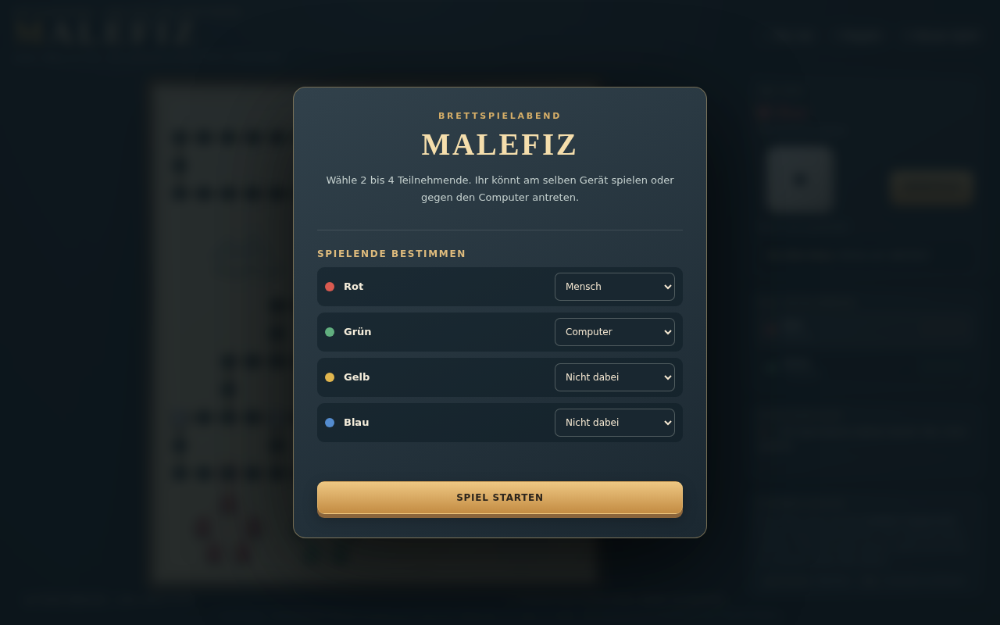

# MALEFIZ – Offline-Brettspiel V5 🎲

## Das Spiel

Der deutsche Brettspielklassiker aus dem Jahr 1960 – vollständig im Browser, ohne Installation. Bis zu vier Spieler (Mensch oder KI) versuchen als Erster, alle fünf eigenen Figuren auf das Zielfeld in der Mitte zu bringen. Sperrsteine blockieren den Weg, Gegner werden zurück auf Start geschlagen, und Würfelpech kann alles zunichte machen.

## Wie man spielt

- **Ziel:** Alle fünf eigenen Figuren auf das Zielfeld (Mitte oben) bringen
- **Zugregeln:** Würfeln, dann eine eigene Figur genau die gewürfelte Anzahl Felder ziehen
- **Sperrsteine schlagen:** Landet eine Figur auf einem Sperrstein, darf der Sperrstein beliebig neu auf dem Brett platziert werden
- **Gegner schlagen:** Landet eine Figur auf einer gegnerischen Figur, muss diese zurück auf Start
- **Brückenfelder:** Bestimmte Querverbindungen ermöglichen Abkürzungen – und Fallen

## Features

✅ Vollständige Malefiz-Regeln inkl. Sperrsteine und Brückenfelder  
✅ 1–4 Spieler mit KI-Gegnern (Human/Computer frei wählbar)  
✅ 3D-animierter Würfel mit Soundeffekte  
✅ Spielzug-Log für jeden Runde  
✅ Speichern & Wiederherstellen via localStorage  
✅ Vollständig responsiv (Mobile-freundlich)  
✅ Regeln-Overlay im Spiel abrufbar  

## Schwierigkeitsgrad

⭐⭐ Leicht bis Mittel – einfache Regeln, aber der Glücksfaktor (Würfel + Sperrstein-Platzierung der KI) sorgt für Überraschungen

---

[← Zurück zur Übersicht](../../README.md)
