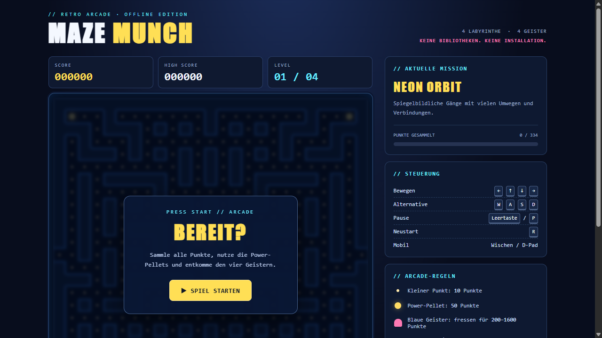

# MAZE MUNCH · Browser Arcade 🕹️👻

## Das Spiel

Klassischer Maze-Runner mit Ghosts und Pellets. Retro-Arcade-Feeling trifft Browser-Kompatibilität.

## Wie man spielt

- **Ziel:** Alle Pellets essen ohne von Ghosts gefangen zu werden
- **Steuerung:** Pfeiltasten – bewegen durch Labyrinthe
- **Power-ups:** Gelegentliche Invulnerabilität (dann sind die Ghosts dran)

## Features

✅ Klassisches Arcade-Gameplay  
✅ Mehrere Levels  
✅ Ghost-KI (einfach bis verwirrend)  
✅ Score-System  
⚠️ Ghost-AI macht unerwartete Moves

## Known Issues

- Ghosts können manchmal feststecken (oder durchwalken)
- Level-Wechsel-Übergänge teils abrupt
- Sound-Loop kann sich überlappen

## Schwierigkeitsgrad

⭐⭐⭐ Klassischer Mittelwert

---

[← Zurück zur Übersicht](../../README.md)
