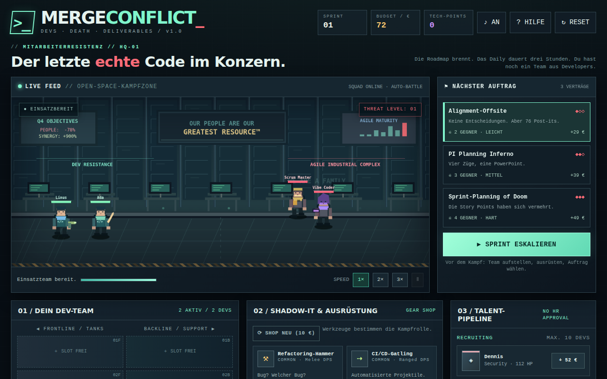

# MERGE CONFLICT – Devs vs. Buzzwords ⚔️

## Das Spiel

Ein Squad-basierter Tactical Auto-Battler mit Roguelite-Elementen – und einem ordentlichen Schuss Agile-Satire. Du bist der letzte echte Tech-Lead im Konzern. Stell dein Entwickler-Team zusammen, rüste sie mit Shadow-IT-Equipment aus und schicke sie in automatisch ablaufende Sprint-Kämpfe gegen Scrum-Master, OKR-Coaches, Vibing-POs und andere Buzzword-Kreaturen. Zwischen den Sprints kaufst du, recruitest und upgradest – bis das Budget brennt oder das Daily drei Stunden dauert.

## Wie man spielt

- **Ziel:** Möglichst viele Sprints überleben und den Endboss (das Quartals-Rebranding) besiegen
- **Vorbereitung:** Team aufstellen (Frontline/Backline), Werkzeuge & Gadgets ausrüsten, Mission auswählen
- **Kampf:** Läuft vollständig automatisch – Einheiten kämpfen in Echtzeit auf dem Canvas-Schlachtfeld
- **Zwischen den Sprints:** Neue Devs rekrutieren, Shop neu würfeln, Team in der Kaffeeküche heilen
- **Ressourcen:** Budget (€) für Käufe, Tech-Points für permanente Meta-Upgrades

## Features

✅ Auto-Battle-System mit animiertem Canvas-Schlachtfeld  
✅ 6 Developer-Klassen (Tank, Sniper, Support, etc.)  
✅ Werkzeuge & Gadgets mit Seltenheitsstufen (Common → Legendary)  
✅ 10-Slot Squad-Formation (Frontline/Backline)  
✅ Roguelite: Jeder Run startet fresh, Meta-Upgrades bleiben erhalten  
✅ Kampfgeschwindigkeit 1×/2×/3× einstellbar  
✅ Speichern & Wiederherstellen via localStorage  
✅ Kampf-Log, Sprechblasen und Partikeleffekte  
⚠️ Absichtlich broken: Manchmal gehen mehr Leute in den Sprint als herauskommen  

## Schwierigkeitsgrad

⭐⭐⭐⭐ Schwer – die Difficulty-Kurve skaliert mit jedem Sprint. Boss-Sprints (Runde 5, 10, …) sind unerbittlich.

---

[← Zurück zur Übersicht](../../README.md)
