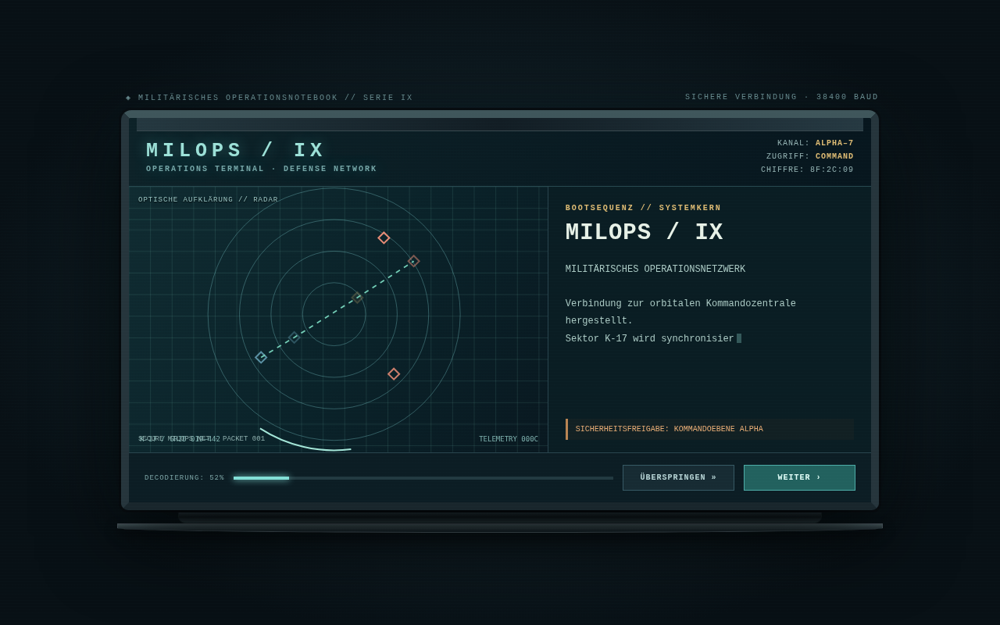
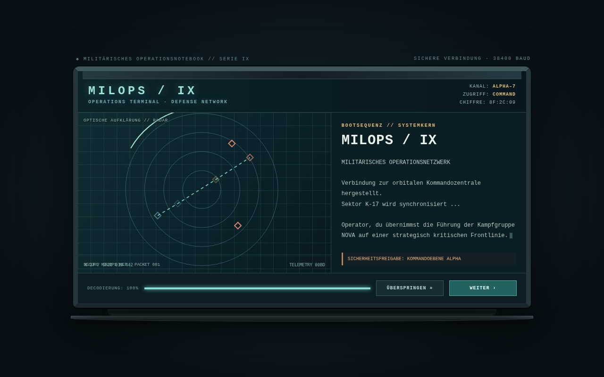
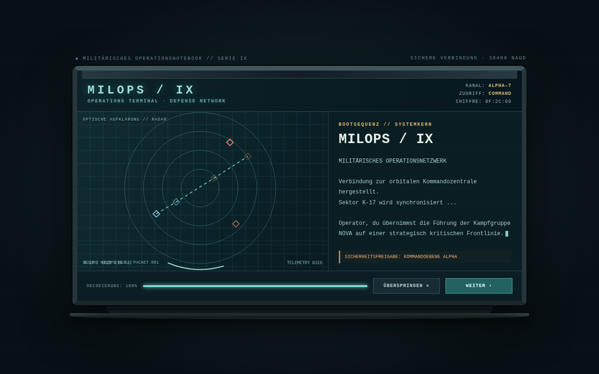

# MILOPS // ECHO FRONT – Hex Tactics 🎯

## Das Spiel

Strategisches Hexagon-Taktikspiel im "vielleicht-gibt-es-einen-Plot"-Modus. Bewege Einheiten auf einem Hexagon-Grid und hoffe, dass die KI-Gegner sich nicht teleportieren.

## Wie man spielt

- **Ziel:** Feinde eliminieren, Punkte holen, oder einfach die Hexagons anstarren
- **Steuerung:** Klick auf Hexagons, wähle Einheiten, bestaune das Chaos
- **Turnsystem:** Dein Turn, KI-Turn, Bug-Turn (unerwartet)

## Features

✅ Hexagon-basiertes Spielfeld  
✅ Unterschiedliche Einheit-Typen  
✅ Militärischer Sci-Fi-Flair  
✅ "ECHO FRONT"-Atmosphäre  
⚠️ Pathfinding kann kreative Umwege nehmen

## Known Issues

- Einheiten laufen manchmal durch Wände
- KI-Zug dauert länger als erwartet (denkt nach? macht Fehler? niemand weiß)
- Nebel-Effekte können Performance killen

## Schwierigkeitsgrad

⭐⭐⭐⭐ Knifflig

---

[← Zurück zur Übersicht](../../README.md)
