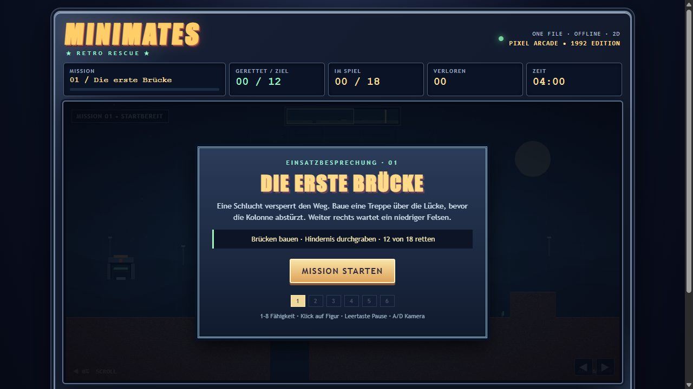

# MINIMATES — Retro Rescue 🕹️👶

## Das Spiel

Pixeliges Rettungs-Adventure. Kleine Charaktere müssen Ärger entkommen, durch Level springen, sammeln, überleben.

## Wie man spielt

- **Ziel:** Durch alle Level kommen ohne zu sterben (schwieriger als es klingt)
- **Steuerung:** Pfeiltasten – Jump, Laufen, evtl. Power-ups nutzen
- **Schwierigkeit:** Klassisch brutal

## Features

✅ Pixel-Grafik  
✅ Platformer-Gameplay  
✅ Mehrere Level  
✅ Retro-Charm  
⚠️ Hitboxes gefährlich groß

## Known Issues

- Jump-Physik bleibt manchmal an Wänden hängen
- Schwierigkeit sprunghaft zwischen Level
- Collision-Detection manchmal zu tolerant

## Schwierigkeitsgrad

⭐⭐⭐⭐ Alt-School hart

---

[← Zurück zur Übersicht](../../README.md)
