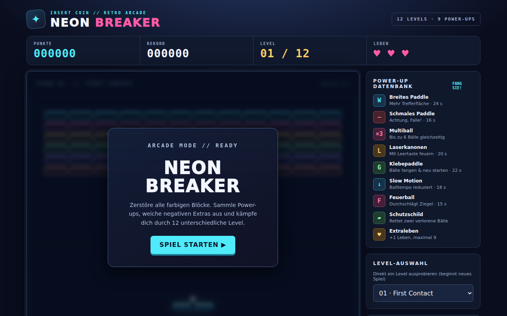
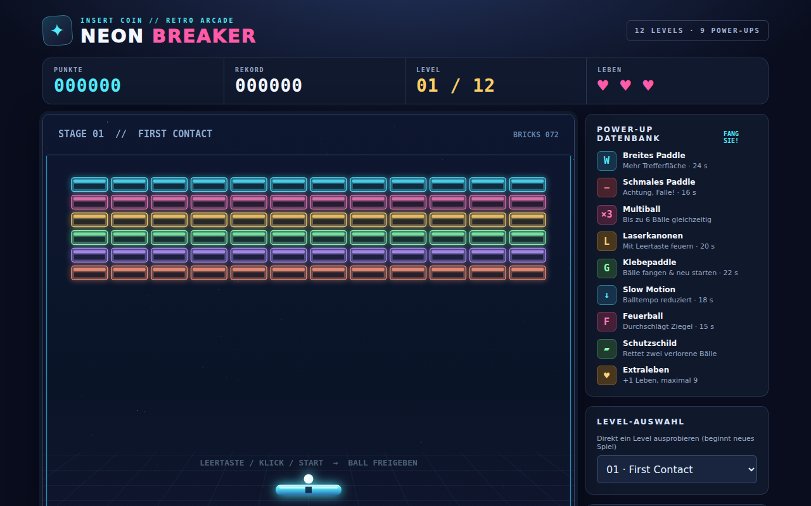
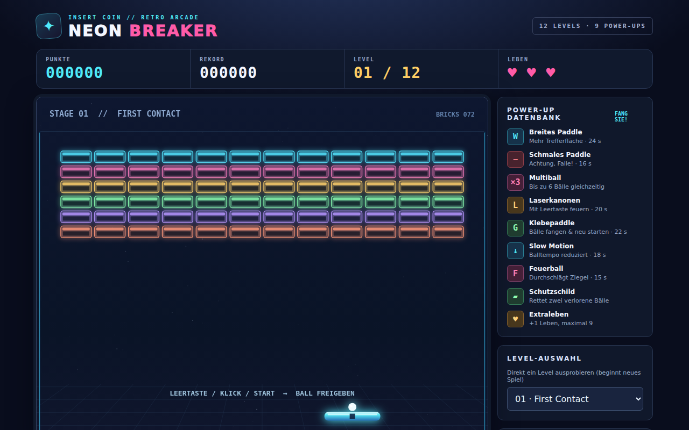

# Neon Breaker — Retro Brick Arcade 🎨🧱

## Das Spiel

Brick-Breaker mit Neon-Vibes. Zerstöre farbige Steine mit dem Ball, verfehle nicht das Paddel, überlebe Level um Level.

## Wie man spielt

- **Ziel:** Alle Steine zerstören, ohne dass der Ball unten rausfällt
- **Steuerung:** Maus/Pfeiltasten – Paddel bewegen
- **Schwierigkeit:** Steigt kontinuierlich oder ist manchmal plötzlich hart

## Features

✅ Klassisches Brick-Breaking  
✅ Neon-Grafik-Effekte  
✅ Power-ups  
✅ Progressive Level  
⚠️ Ball-Physik kann unvorhersehbar sein

## Known Issues

- Ball-Spin manchmal sehr spinny
- Power-ups können sich überlappen (macht es konfus)
- Performance bei vielen Partikeln schlechter

## Schwierigkeitsgrad

⭐⭐⭐ Mittel bis knifflig

---

[← Zurück zur Übersicht](../../README.md)
