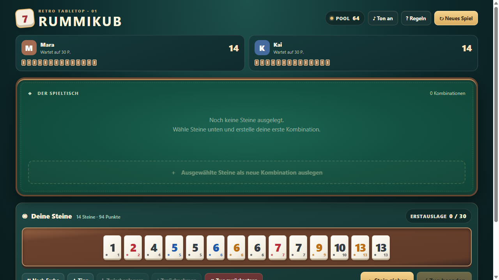

# Rummikub · Retro Browser Edition 🎲

## Das Spiel

Der Klassiker aus Omas Spielzimmer – jetzt im Browser! Kombiniere Nummern-Sets, bilde Sequenzen, vermeide es zu verlieren (oder verliere einfach ehrenvoll).

## Wie man spielt

- **Ziel:** Alle deine Tiles auf dem Tisch spielen und Spiel beenden
- **Steuerung:** Zieh-und-Drop Tiles, manipuliere Kombinationen
- **Strategie:** Nötig, aber Glück ist wichtiger

## Features

✅ Klassische Rummikub-Regeln  
✅ Singleplayer gegen KI  
✅ Retro Design  
✅ Undo-Button (manchmal)  
⚠️ Tile-Logik manchmal unklar

## Known Issues

- Tile-Drag-and-Drop fühlt sich teils laggy an
- KI-Züge dauern länger als nötig
- Gewinn-Bedingung kann nach mehreren Zügen buggen

## Schwierigkeitsgrad

⭐⭐⭐ Mittelschwer (KI ist doof)

---

[← Zurück zur Übersicht](../../README.md)
