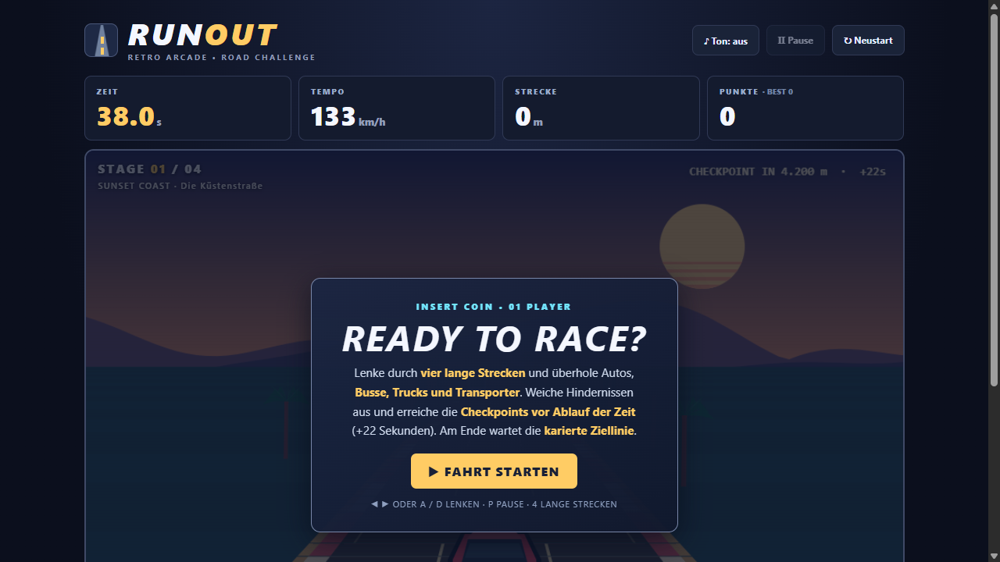

# RUNOUT 1.2 — Retro Arcade Road Challenge 🚗

## Das Spiel

Fahre durch eine endlose Straße, weiche Hindernissen aus, sammle Power-ups, vermeide Crashes. Version 1.2 (also besser als 1.1, aber nicht perfekt).

## Wie man spielt

- **Ziel:** Möglichst lange fahren ohne zu crashen
- **Steuerung:** Pfeiltasten – Links/Rechts lenken, manchmal Beschleunigung
- **Gegner:** Andere Autos, Hindernisse, deine eigene Unfähigkeit

## Features

✅ Endloses Arcade-Gameplay  
✅ Progressive Schwierigkeit  
✅ Power-up System  
✅ Retro-Grafik  
⚠️ Hitbox-Größe fraglich

## Known Issues

- Collision manchmal zu früh oder zu spät
- Road-Scrolling kann bei schnellen Moves glitchen
- Power-up-Effekte duration unklar

## Schwierigkeitsgrad

⭐⭐⭐ Konstant mittelschwer

---

[← Zurück zur Übersicht](../../README.md)
