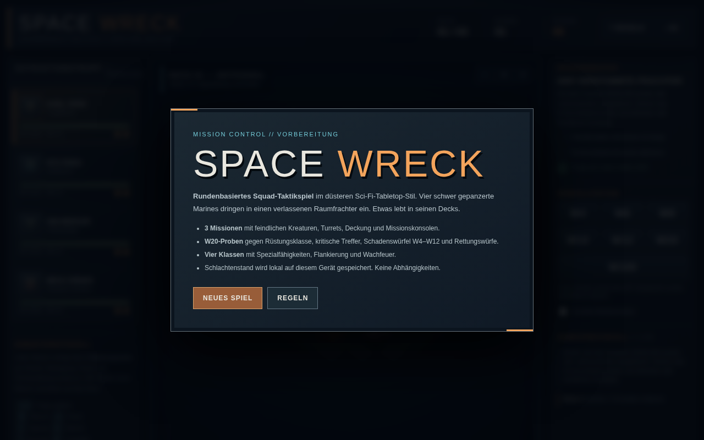
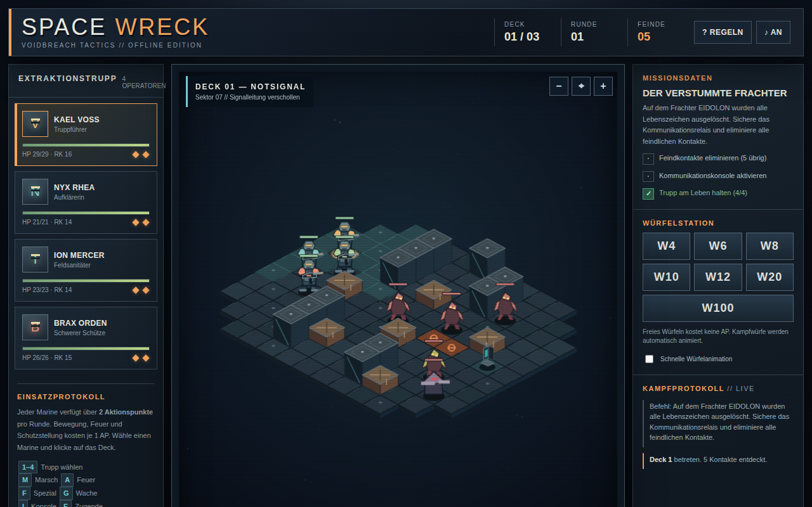
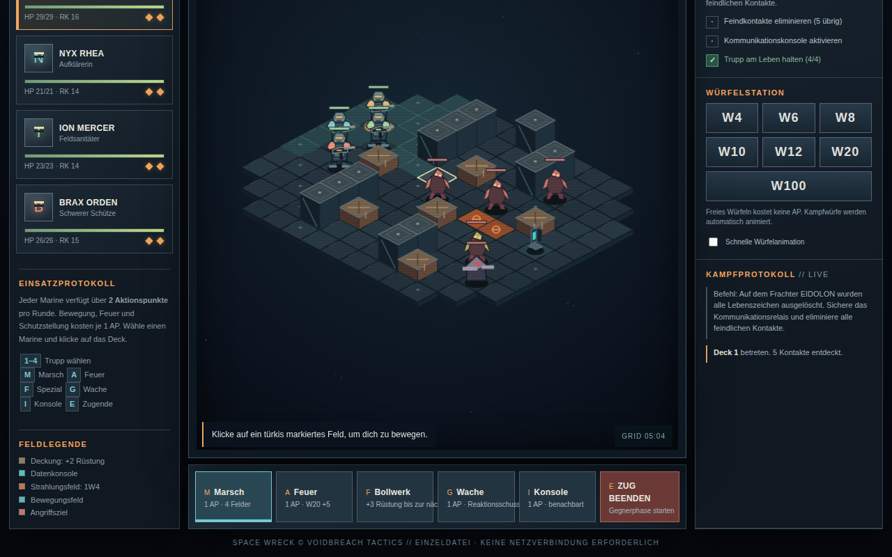

# SPACE WRECK – Voidbreach Tactics 🚀🌌

## Das Spiel

Science-Fiction Taktikspiel im All. Deine Raumschiff-Crews kämpfen gegen die Mysterien des Void. Oder gegeneinander. Es ist eigentlich egal, solange es explodiert.

## Wie man spielt

- **Ziel:** Gegnerische Schiffe zerstören und nicht selbst explodieren
- **Steuerung:** Maus – Einheiten bewegen, Waffen abfeuern, hoffen
- **Ressourcen:** Energie, Ammo, Hoffnung (hauptsächlich die dritte)

## Features

✅ Raumschiff-Taktik  
✅ Weltraum-Szenarien  
✅ Mehrere Waffen-Typen  
✅ Nebel-Effekte für Atmosphäre (und FPS-Probleme)  
⚠️ Physik-Engine nimmt sich Freiheiten

## Known Issues

- Kollisionen mit Asteroiden zufällig
- Waffen-Reichweite manchmal großzügig interpretiert
- Explosion-Animation kann sich wiederholen (oder stecken bleiben)

## Schwierigkeitsgrad

⭐⭐⭐⭐ Hart

---

[← Zurück zur Übersicht](../../README.md)
