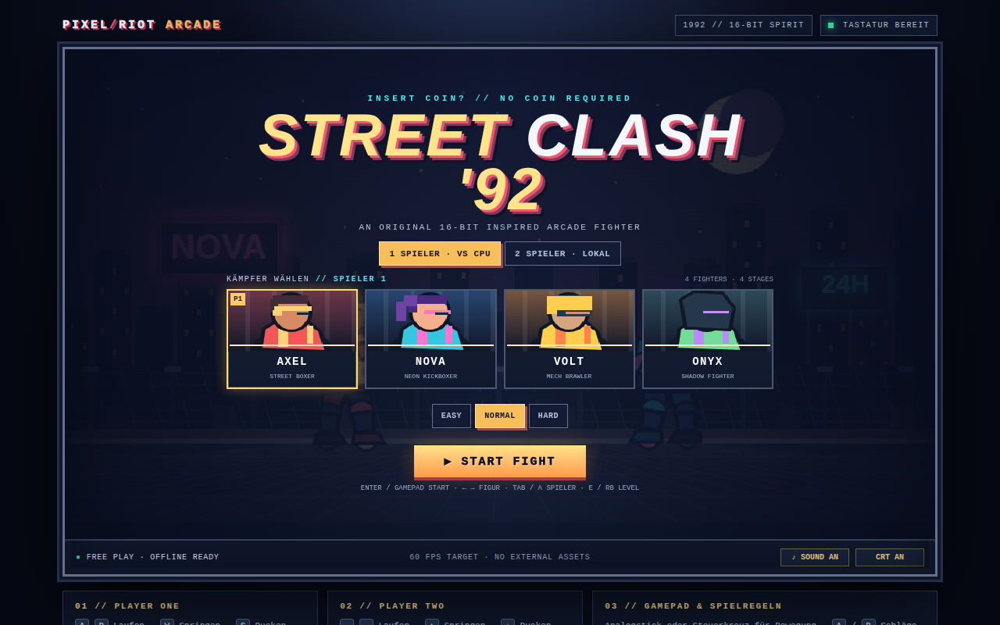
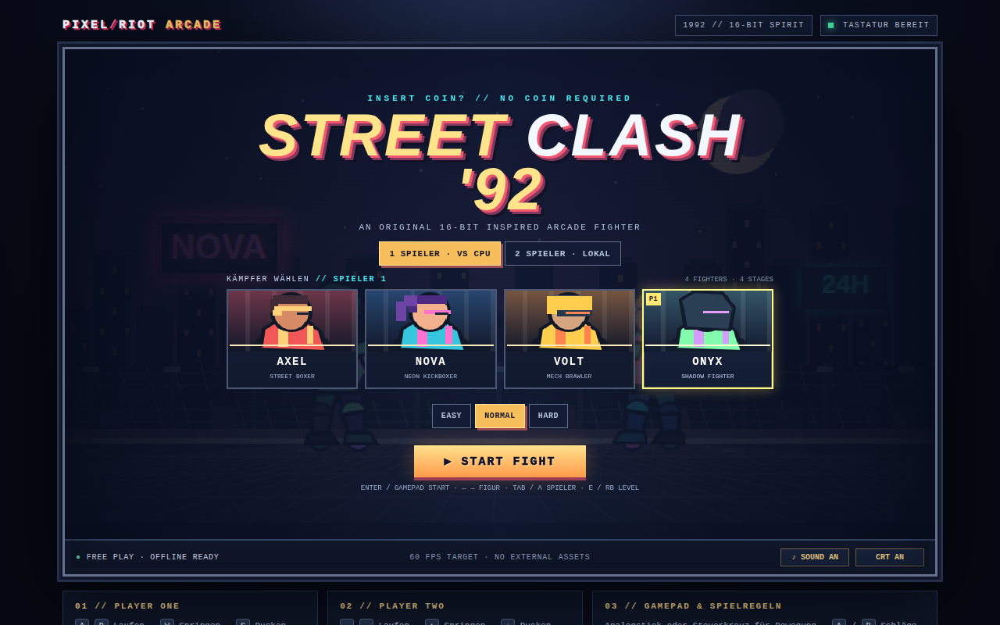
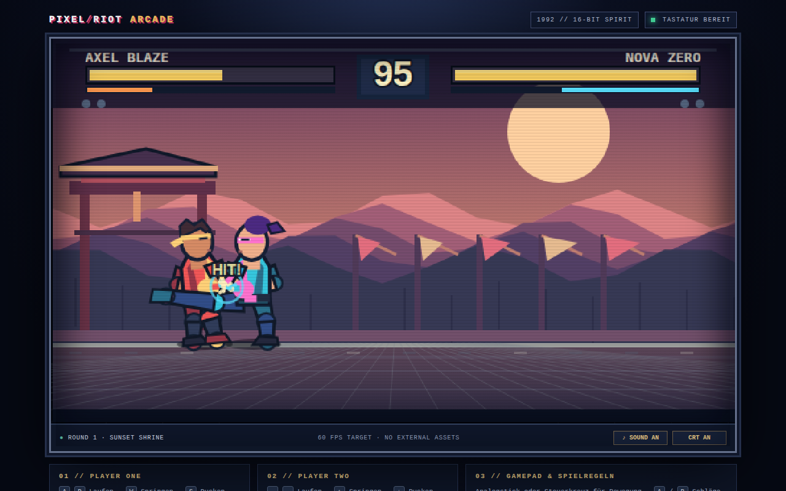

# STREET CLASH '92 — Offline Arcade Fighter 🥊

## Das Spiel

1v1 Fighting Game im 16-Bit Style. Punch, Kick, Special Move, hoffen die Hitboxen stimmen.

## Wie man spielt

- **Ziel:** Gegner K.O. schicken (bevor er/sie dich K.O. schickt)
- **Steuerung:** WASD oder Pfeiltasten – bewegen, Maus/Buttons – angreifen
- **Combos:** Es gibt sie, aber du weißt nicht sicher, ob sie funktionieren

## Features

✅ 2-Player Mode  
✅ Mehrere Charaktere  
✅ Special Moves & Combos  
✅ Health/Energy Bars  
⚠️ Hitbox-Registrierung... kreativ

## Known Issues

- Combos manchmal buggy (oder manchmal OP)
- Knockback-Animation kann stuck werden
- Sound-Sync mit Animation zeitweise weg

## Schwierigkeitsgrad

⭐⭐⭐⭐ Mittelschwer bis "dieser Bot ist unfair"

---

[← Zurück zur Übersicht](../../README.md)
