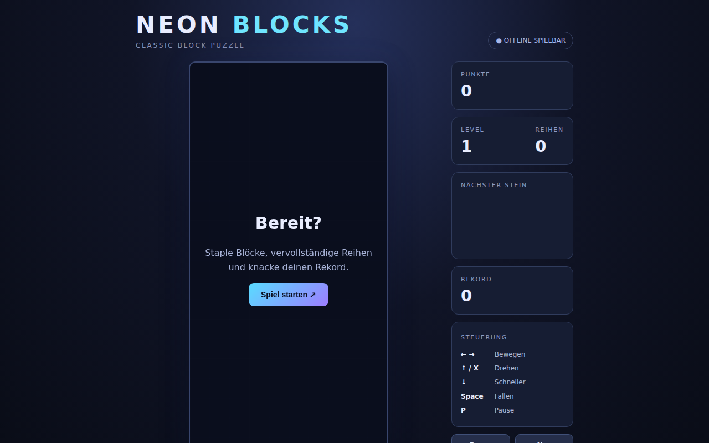
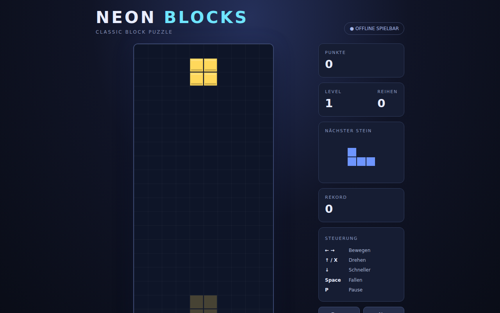
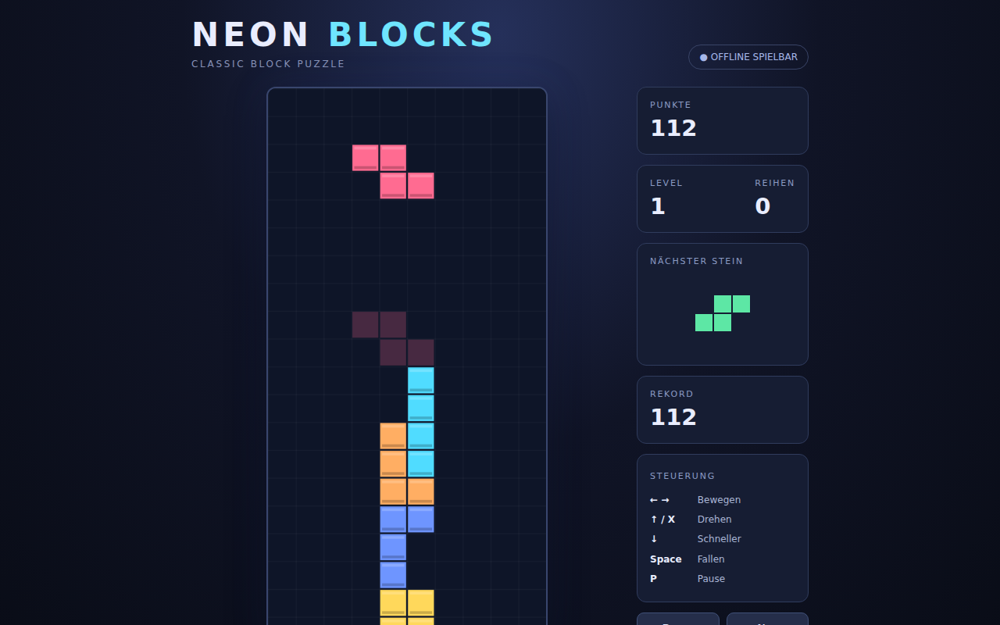

# NEON BLOCKS — Browser Tetris 🟨🟦

## Das Spiel

Das legendäre Tetris in Browser-Form mit Neon-Flair. Stack es, clear es, bis du pleite bist.

## Wie man spielt

- **Ziel:** Reihen komplett machen, sie verschwinden lassen, nicht die Höhe erreichen
- **Steuerung:** Pfeiltasten – Links/Rechts bewegen, Oben – rotieren, Unten – schneller fallen
- **Schwierigkeit:** Beginnt langsam, wird exponentiell schneller

## Features

✅ Klassisches Tetris-Gameplay  
✅ Neon-Optik  
✅ Rotation & Movement  
✅ Score & Lines-Tracking  
⚠️ Rotation manchmal clunky in Ecken

## Known Issues

- Wall-Kick nicht konsistent
- Nächster-Piece-Preview kann verwirrend sein
- Speed-Anstieg manchmal zu abrupt

## Schwierigkeitsgrad

⭐⭐⭐⭐ Das hängt davon ab, wie fokussiert du bist

---

[← Zurück zur Übersicht](../../README.md)
