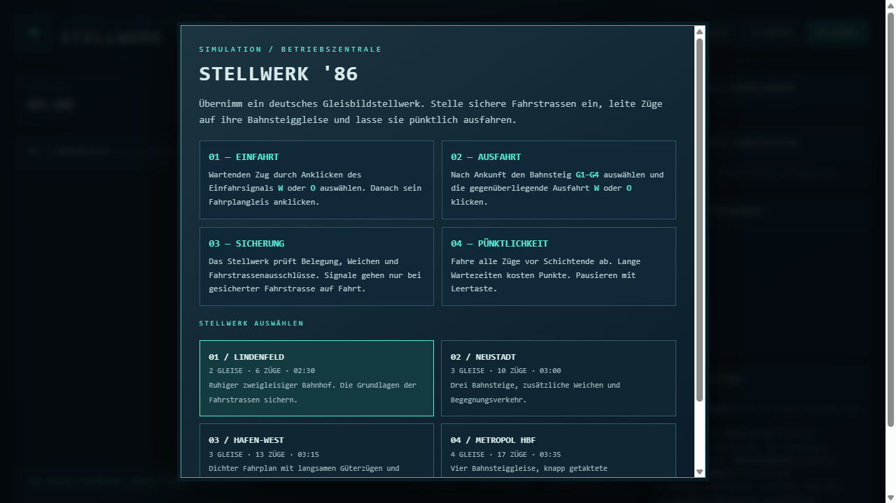

# STELLWERK '86 – Train Dispatcher 🚂

## Das Spiel

Züge dirigieren wie ein Maestro – aber alle Musikanten ignorieren die Noten. Ein Echtzeit-Taktik-Puzzle über Rail-Management und kontrolliertes Chaos.

## Wie man spielt

- **Ziel:** Züge pünktlich ans Ziel bringen (oder auch einfach irgendwo hin)
- **Steuerung:** Klick auf Gleise, setze Weichen, hoffe dass kein Crash passiert
- **Schwierigkeit:** Eskaliert schnell von "machbar" zu "Züge everywhere"

## Features

✅ Echtzeit-Management  
✅ Realistisches Zug-Verhalten (etwa so wie das echte Leben)  
✅ Mehrere Strecken und Bahnhöfe  
✅ Zeitdruck  
⚠️ Collision-Handling manchmal überraschend

## Known Issues

- Züge können "stecken bleiben" wenn du pech hast
- Weichen-Timing ist kritisch (und nicht intuitiv)
- Crash-Animation looped manchmal endlos

## Schwierigkeitsgrad

⭐⭐⭐⭐⭐ "Warum mache ich mir das an?"

---

[← Zurück zur Übersicht](../../README.md)
