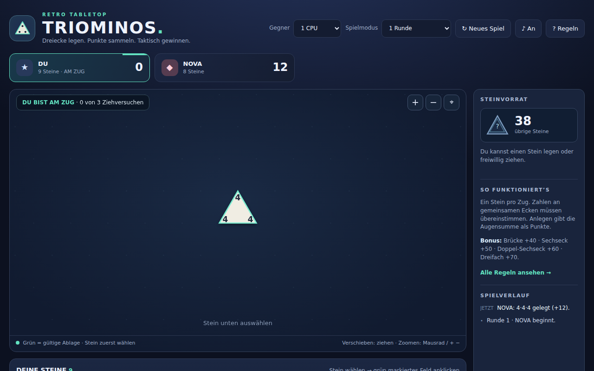
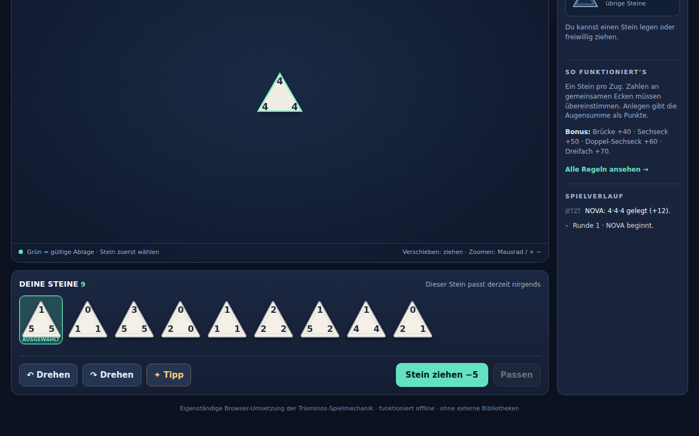

# Triominos · Browser Edition 🔺

## Das Spiel

Das Pendant zu Domino, aber mit Dreiecken statt Rechtecken. Lege Steine, sammle Punkte, oder stecke fest und pass.

## Wie man spielt

- **Ziel:** Alle deine Triomino-Steine spielen (oder am wenigsten Punkte haben)
- **Steuerung:** Klick um Stein zu wählen, Drop auf gültiges Feld
- **Logik:** Seiten müssen passen (oder Wildcards nutzen)

## Features

✅ Triomino-Spielmechanik  
✅ Mehrere Spieler-Modi  
✅ Score-Tracking  
✅ Undo-Funktion (wo vorhanden)  
⚠️ Validierung von gültigen Zügen manchmal fragwürdig

## Known Issues

- Stein-Rotation nicht immer intuitiv
- Match-Validierung kann false positives haben
- Board-Rendering kann bei großen Spielen verlangsamen

## Schwierigkeitsgrad

⭐⭐ Einfach bis mittelschwer

---

[← Zurück zur Übersicht](../../README.md)
