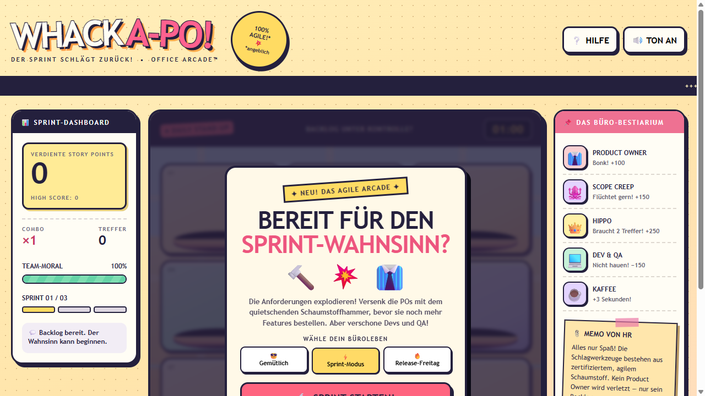

# WHACK-A-PO! — Der Sprint schlägt zurück 🔨😤

## Das Spiel

Product Owner Whack-A-Mole Parodie. Ein PO taucht auf, du schlagst (oder ignorierst) ihn, er taucht wieder auf. Sprint-Humor trifft Arcade.

## Wie man spielt

- **Ziel:** Möglichst schnell auf die auftauchenden POs hauen, bevor sie verschwinden
- **Steuerung:** Maus – klicke auf POs wenn sie erscheinen
- **Schwierigkeit:** Tempo nimmt zu, Hitbox wird winzig

## Features

✅ PO-Whack Mechanic  
✅ Agile-Humor  
✅ Speed-Challenge  
✅ Score-Tracking  
⚠️ Hitbox-Größe fraglich

## Known Issues

- PO-Spawn-Rate manchmal bugs
- Hit-Detection ungenau (oder du bist einfach langsam)
- Sound-Effekte overlappen

## Schwierigkeitsgrad

⭐⭐⭐ Reflex-Challenge

---

[← Zurück zur Übersicht](../../README.md)
