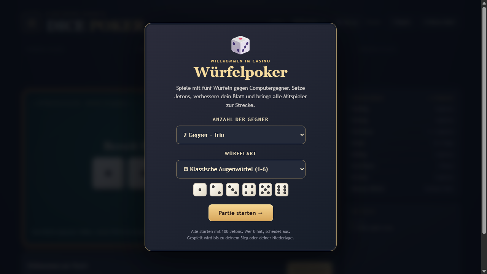

# Dice Poker – Retro Würfelpoker 🎲♠️

## Das Spiel

Poker mit Würfeln statt Karten. Würfel werfen, Kombinationen bilden, Bluffing ist eine Lebensstrategie. Gewinne oder verliere virtuelles Geld.

## Wie man spielt

- **Ziel:** Beste Würfel-Hand haben oder erfolgreich geblufft haben
- **Steuerung:** Klick um Würfel neu zu werfen, wette auf deine Hand
- **Taktik:** Bluff, reraise, hoffen

## Features

✅ Klassisches Würfelpoker  
✅ Mehrere Bots  
✅ Bankroll-Tracking  
✅ Retro-Optik  
⚠️ Wahrscheinlichkeits-Berechnung der KI suspekt

## Known Issues

- Gewinn-Berechnung manchmal off
- Bots haben seltene strange Betting-Pattern
- Sound-Effekte können sich wiederholen

## Schwierigkeitsgrad

⭐⭐⭐ Glücksabhängig

---

[← Zurück zur Übersicht](../../README.md)
